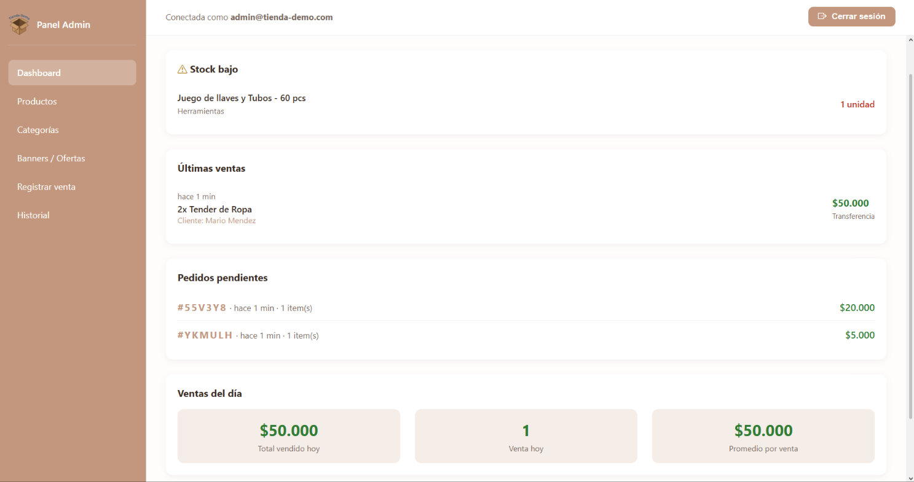
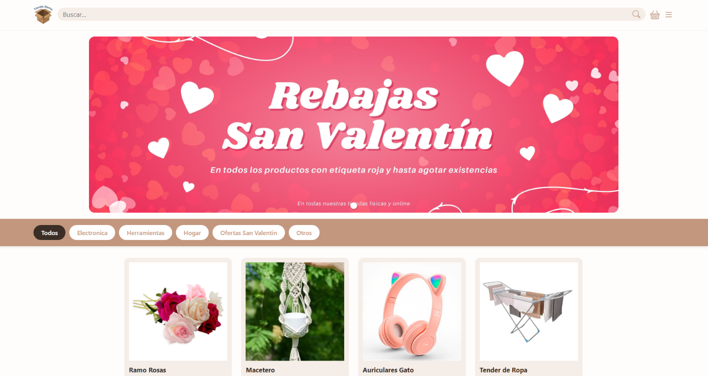
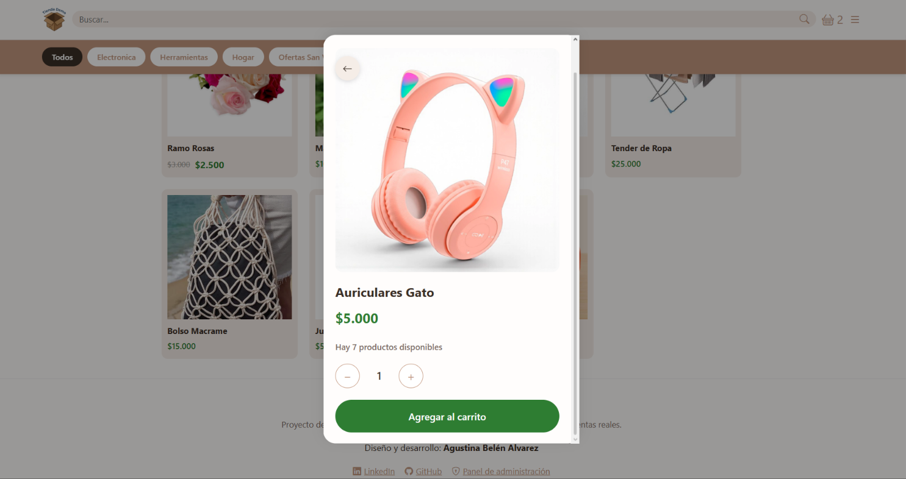

# Tienda Demo — Catálogo + Panel Admin

Catálogo público y panel de administración para un pequeño negocio: productos con stock, ventas y pedidos por WhatsApp.

🔗 **Demo**: [https://tienda-demo-5c115.web.app/catalogo/](https://tienda-demo-5c115.web.app/catalogo/)
🔐 **Admin**: [https://tienda-demo-5c115.web.app/admin/](https://tienda-demo-5c115.web.app/admin/)

**Credenciales de prueba**:
- Email: `admin@tienda-demo.com`
- Password: `demo1234`

> Proyecto de portfolio. Los productos, precios y pedidos son ficticios. Los datos pueden reiniciarse.

## Capturas





## Características

### Panel de administración
- Dashboard con stock bajo, últimas ventas, pedidos pendientes y resumen del día.
- Productos: CRUD, subida de fotos a Cloudinary, control de stock y estado (borrador / activo / inactivo).
- Categorías: CRUD con validación de duplicados y protección de "Otros".
- Banners: carrusel dinámico con enlaces a categorías.
- Registrar venta: manual o por código de pedido, con múltiples métodos de pago.
- Historial: filtros por fecha, detalle y **anulación con devolución de stock** (transaccional).

### Catálogo público
- Filtros por categoría y buscador con normalización de acentos.
- Carrito persistente (localStorage).
- Validación de stock en tiempo real.
- Ofertas: precio tachado + precio de oferta.
- Banners interactivos que filtran por categoría.
- Checkout por WhatsApp con resumen del pedido.

### Seguridad
- Sanitización con `esc()` en los renderizados principales (productos, banners, ventas, dashboard, historial).
- Reglas de Firestore: solo el admin (por email) puede escribir.
- Validación de estructura de pedidos en las reglas.
- Revalidación de precios contra Firestore al cargar un pedido.
- Transacciones atómicas para ventas y anulaciones.

## Stack

- Frontend: JavaScript vanilla (módulos ES).
- Base de datos: Firebase Firestore.
- Autenticación: Firebase Auth.
- Imágenes: Cloudinary.
- Hosting: Firebase Hosting.
- Testing E2E: Playwright + Firebase Emulator Suite.

## Estructura

```
.
├── tienda-demo/
│   └── public/
│       ├── admin/              # Panel (login + páginas)
│       ├── catalogo/           # Catálogo público
│       └── shared/             # firebase-config.js, utils.js (esc)
├── tests/                      # Playwright specs + helpers + global-setup
├── firestore.rules
├── firebase.json
├── .firebaserc
├── playwright.config.js
└── package.json
```

## Instalación desde cero

**Requisitos:**
- Node.js 18+
- Java 11+ (para el emulador de Firebase)
- Firebase CLI: `npm i -g firebase-tools`
- Una cuenta de Cloudinary (para subir imágenes)

**Pasos:**

```bash
git clone https://github.com/AgusBAlvarez/tienda-demo.git
cd tienda-demo
npm install
npx playwright install
```

**Configurar tu propio Firebase y Cloudinary (opcional):**
- Editá `tienda-demo/public/shared/firebase-config.js` con las credenciales de tu proyecto.
- Editá `CLOUD_NAME` y `UPLOAD_PRESET` en `productos.js` y `banners.js`.
- Reemplazá el email del admin en `firestore.rules` por el tuyo.
- **Creá el usuario admin en Authentication** (Email/Password) con el email que pusiste en las reglas. Sin esto, nadie puede iniciar sesión tras clonar el repo. En local, podés crearlo desde la UI del emulador: `http://localhost:4000/auth`.

**Correr en local (con emuladores):**

```bash
# Terminal 1
firebase emulators:start --only auth,firestore --project <tu-project-id>

# Terminal 2
npx serve . -p 5500

# Terminal 3
npx playwright test --reporter=list
```

> **URLs locales:**
> - Catálogo: `http://localhost:5500/tienda-demo/public/catalogo/index.html`
> - Admin: `http://localhost:5500/tienda-demo/public/admin/index.html`
> 
> La app detecta `localhost` / `127.0.0.1` y se conecta automáticamente a los emuladores.

## Testing

- **40 tests E2E** con Playwright + Firebase Emulator (39 pasando + 1 skip intencional).
- Cobertura: flujo admin (auth, categorías, productos, ventas, historial, anulaciones), catálogo público (carrito, stock, checkout) y regresiones de problemas.
- **7 tests de XSS** que verifican que payloads `` en productos, banners, ventas y dashboard se renderizan como texto plano (no se ejecutan).

Comandos útiles:
```bash
npx playwright test --list        # listar todos los tests
npx playwright test --ui          # modo visual
npx playwright test --debug       # paso a paso
npx playwright show-report        # reporte HTML
```

## Problemas encontrados y mejoras

Los más relevantes:

| # | Problema | Fix |
|---|---|---|
| 1 | Código de pedido colisionable | Código = ID del documento + reintentos |
| 2 | Doble anulación de venta (dos terminales) | Lectura dentro de la transacción + check `anulada` |
| 3 | El pedido tomaba los precios del navegador del cliente | Se leen precios reales de Firestore al confirmar |
| 4 | XSS en nombres de productos y títulos de banners | `esc()` + 7 tests de regresión |
| 5 | Anular venta con producto eliminado rompía la transacción | Aviso al usuario + transacción robusta |
| 6 | Caché de productos en "Registrar venta" no se refrescaba | Invalidar caché al cerrar modal |

<details>
<summary>Otros problemas menores</summary>

| # | Problema | Fix |
|---|---|---|
| 1 | `borrarCategoria` sin batch (huérfanos) | `writeBatch` |
| 2 | `confirm()` bloqueante | Modal propio |
| 3 | `alert()` bloqueante en historial | `mostrarToast` |
| 4 | Botón "Anular" visible en ventas anuladas | Reset de `display` |
| 5 | Carrito no persistía | `localStorage` |
| 6 | No validaba stock | Validación en modal y carrito |
| 7 | Precio de oferta no reflejado | Campo `precioOferta` en productos |
| 8 | `pedidoActual` persistía al cancelar | Limpieza en `cerrarConfirmacion` |
| 9 | `cambiarEstado` leía todos los productos | `getDoc` por ID |
| 10 | Dashboard leía todas las ventas | `where + orderBy` |

</details>

## Seguridad

### XSS
Función `esc()` en `shared/utils.js` que escapa `& < > " '`. Aplicada en los `innerHTML` que renderizan datos dinámicos. Cubierta por 7 tests que siembran payloads reales y verifican que **no se ejecutan**.

### Reglas de Firestore
```javascript
function esAdmin() {
  return request.auth != null
    && request.auth.token.email == 'admin@tienda-demo.com';
}
```

> Nota: usar el email como identificador del admin es una **simplificación para la demo**. En un proyecto real conviene usar el UID (`request.auth.uid`) y un documento `admins/{uid}` para no depender de un email hardcodeado.

### Validación de pedidos
- Solo se aceptan los campos `codigo`, `fecha`, `items`, `total`, `estado`.
- El código debe coincidir con el ID del documento.
- `total` numérico y no negativo.
- `fecha` debe ser `serverTimestamp`.

> Las reglas **no pueden validar el contenido de cada item** del pedido. Por eso el panel revalida productos, stock y precios contra Firestore al confirmar la venta.

## Limitaciones conocidas

- Sin paginación (los listados traen todo).
- Sin roles: un único admin por email; no hay cuentas por empleado.
- Sin devoluciones parciales con reembolso (solo anulación con devolución de stock).
- Las ofertas no tienen fecha de vencimiento: se activan/desactivan manualmente.
- Cualquiera puede crear pedidos sin límite (App Check lo mitigaría).
- El preset de Cloudinary está a la vista en un repo público. Conviene limitarlo (formatos y tamaño máximo) desde su configuración.
- El registro público de Firebase Auth está **desactivado** en la demo publicada (solo el admin puede iniciar sesión).
- La `apiKey` visible en `firebase-config.js` **no es un secreto**: es un identificador público. La seguridad la dan las reglas de Firestore y los dominios autorizados en Auth.

## Roadmap (ideas)

- Devoluciones parciales con reembolso.
- Roles por empleado (Firestore + custom claims; requiere SDK de administrador).
- Paginación en listados.
- App Check.
- Tests de carga con `k6` o similar.

## Deploy

```bash
firebase deploy --only hosting,firestore:rules
```

## Autora

**Agustina Belén Alvarez**
- [LinkedIn](https://linkedin.com/in/agustinabelenalvarez)
- [GitHub](https://github.com/AgusBAlvarez)

## Licencia

MIT — ver [LICENSE](LICENSE).